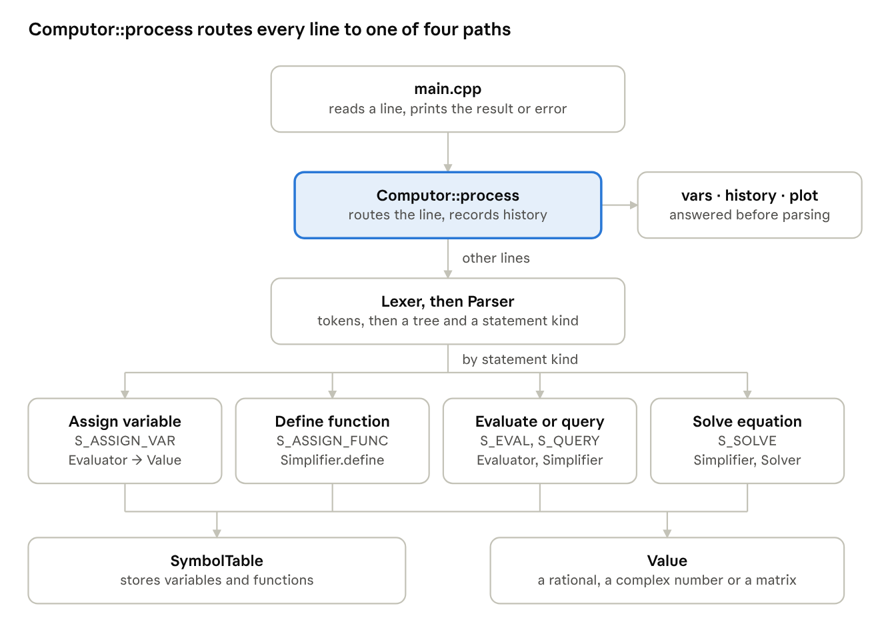

# Computor v2 – Project Documentation

Authored by Muazzam Akhtar · Nov 26, 2026

## Description

Computor v2 is an interactive command-line calculator, written in C++11, that remembers variables and functions between lines and computes with rational numbers, complex numbers and matrices. It also simplifies expressions and solves equations of degree 2 or less, on the reals or the complex numbers. It is the second project of the Computor series, built on the polynomial solver of the first one, and it follows the 42 subject "Computor v2" (version 3.1).

No native or library complex-number or matrix type is used: `Rational`, `Complex` and `Matrix` are implemented from scratch, and the project compiles with `-Wall -Wextra -Werror`.

**Mandatory part**

- Types: rationals, complex numbers (`a + bi`), matrices (`[[1,2];[3,4]]`) and one-variable functions (`f(x) = 2*x + 1`).
- Assignment by type inference, reassignment to another type, and variable-to-variable assignment.
- Operators `+ - * / %`, power `^` (integer, zero or positive), matrix product `**`, term-to-term `*`, parentheses and priorities.
- Queries with `= ?`, function images (`funA(2) + funB(4) = ?`) and polynomial simplification, for example `(x^2 + 3x + 2)/(x + 1)` gives `x + 2`.
- Equation solving (`funA(x) = y ?`) with the answer on R or C, in the subject's wording (`Une solution sur R :`).
- Case-insensitive names made of letters only, `i` reserved, and clear error messages that never stop the session.
- Exit by `exit`, `quit`, Ctrl-D or Ctrl-C.

**Bonus part**

- Function composition (`funA(funB(x))`), and the commands `vars` and `history`.
- Built-in functions `abs`, `sqrt`, `exp`, `sin`, `cos`, `tan` (angles in radians).
- Matrix and vector tools `norm`, `inv`, `det`, `transpose`.
- `plot f [min max]`, an ASCII curve of a function (default range -10 to 10).

**Build and run**

```
make
./computorv2
> varA = 2*i + 3
  3 + 2i
```

Other targets: `make re`, `make clean`, `make fclean`, `make unit` (unit tests) and `sh tests/run.sh` (regression cases).

## Orchestrator

The `Computor` class (`includes/Computor.hpp`, `srcs/Computor.cpp`) is the orchestrator: `main.cpp` hands it each line, its `process` function decides which module handles the line, and it returns the text to print.



The commands `vars`, `history` and `plot` are answered before any parsing. Every other line is parsed into a statement, and the statement's kind selects one of four paths. All four paths read and write the symbol table and compute with `Value`, which wraps `Rational`, `Complex` and `Matrix`.

`Computor` itself owns:

- the symbol table, with every variable and function stored so far;
- the history of successful lines and their results;
- the reserved-name checks (`i`, the built-in functions, `vars`, `history`, `plot`);
- the output layout (two-space indent) and the solver's wording.

Errors are thrown as exceptions from any module and caught in `main.cpp`, which prints them and keeps the session running, so a failed line never changes the stored state.

## Number of files

The project holds 76 source files and about 4,000 lines of code, not counting build output (`.o`, `.d` and the `computorv2` binary).

| Folder | Files | Contents |
| --- | --- | --- |
| `includes/` | 17 | Header files, 579 lines |
| `srcs/` | 20 | 16 program sources (2,317 lines) and 4 unit-test sources (1,060 lines) |
| `tests/` | 36 | 2 test scripts (88 lines) and 34 case files: 17 inputs (`.in`) with their expected outputs (`.out`) |
| project root | 3 | `Makefile`, `README.md`, `Docs.md` |
| **Total** | **76** |  |

## Role of each file

Each header in `includes/` declares one module; the matching `.cpp` in `srcs/` implements it.

### Program entry and orchestration

| File | Role |
| --- | --- |
| `srcs/main.cpp` | Program entry. Runs the read-evaluate-print loop, handles `exit`, `quit`, Ctrl-D and Ctrl-C, and prints errors without stopping. |
| `includes/Computor.hpp`, `srcs/Computor.cpp` | The orchestrator. Receives each line, answers the `vars`, `history` and `plot` commands, and sends every other line through parse, evaluate or simplify, and solve. Keeps the symbol table and the history. |

### Reading the input

| File | Role |
| --- | --- |
| `includes/Token.hpp`, `srcs/Lexer.cpp` | Token types and the lexer. Splits a line into numbers, names, operators and brackets, lowercases names, and rejects invalid characters, `i` as a name, and names with digits. Also defines `SyntaxError`. |
| `includes/Parser.hpp`, `srcs/Parser.cpp` | Recursive-descent parser. Builds the expression tree with the right priorities and classifies each line as an evaluation, a query (`= ?`), an equation (`... = ... ?`), a variable assignment or a function definition. |
| `includes/Ast.hpp`, `srcs/Ast.cpp` | Expression tree node types (number, imaginary, variable, unary, binary, matrix, function call, constant) and their printing with minimal parentheses. |

### Number types

| File | Role |
| --- | --- |
| `includes/Rational.hpp`, `srcs/Rational.cpp` | The rational number type. Stores a double, compares with a 1e-10 tolerance, refuses division by zero, and prints up to 9 decimals. |
| `includes/Complex.hpp`, `srcs/Complex.cpp` | Complex numbers with rational real and imaginary parts: arithmetic, square root, modulo and display (`3 + 2i`). Written from scratch, with no `std::complex`. |
| `includes/Matrix.hpp`, `srcs/Matrix.cpp` | Matrices of complex numbers: addition, subtraction, term-to-term `*`, matrix product `**`, powers, transpose, determinant, inverse, and size-checked errors. |
| `includes/Value.hpp`, `srcs/Value.cpp` | One value that is either a scalar (rational or complex) or a matrix. Dispatches each operator to the right type and reports clear errors for unsupported combinations. |

### Variables, functions and equations

| File | Role |
| --- | --- |
| `includes/SymbolTable.hpp`, `srcs/SymbolTable.cpp` | Stores the named variables and functions, and reports unknown names. |
| `includes/Function.hpp` | A stored function: its parameter, its body tree, and its polynomial form when it has one. Header only. |
| `includes/Evaluator.hpp`, `srcs/Evaluator.cpp` | Evaluates an expression tree to a `Value` and calls functions with a given argument. |
| `includes/Simplifier.hpp`, `srcs/Simplifier.cpp` | Defines functions: inlines variables and other functions (composition), converts the body to a polynomial, divides polynomials when it can, and finds the unknown names of an expression. |
| `includes/Polynomial.hpp`, `srcs/Polynomial.cpp` | Polynomial with complex coefficients: add, subtract, multiply, power, divide, evaluate and print (`x^2 + 2 * x + 1`). |
| `includes/Solver.hpp`, `srcs/Solver.cpp` | Solves polynomials of degree 2 or less: no solution, every number, or one or two roots on R or C. Refuses higher degrees. |

### Bonus modules

| File | Role |
| --- | --- |
| `includes/Builtins.hpp`, `srcs/Builtins.cpp` | Built-in functions `abs`, `sqrt`, `exp`, `sin`, `cos`, `tan` (radians), `norm`, `inv`, `det` and `transpose`. Their names are reserved. |
| `includes/Plotter.hpp`, `srcs/Plotter.cpp` | The `plot` command: samples a function over a range and draws an ASCII curve with axes, leaving gaps where it is undefined or huge. |

### Build and project files

| File | Role |
| --- | --- |
| `Makefile` | Builds `computorv2` with `c++ -std=c++11 -Wall -Wextra -Werror`. Rules: `all`, `bonus`, `clean`, `fclean`, `re`, `unit` and `debug`. Relinks only when a file changed. |
| `README.md` | Work log and notes per sprint. |
| `Docs.md` | Project plan: constraints from the subject, sprint breakdown and README template. |

### Tests

| File | Role |
| --- | --- |
| `srcs/test.cpp` | Unit tests for the lexer, expression printing, the parser and statement classification. |
| `srcs/test_eval.cpp` | Unit tests for values, the symbol table, the evaluator and variables through `Computor`. |
| `srcs/test_matrix.cpp` | Unit tests for `Matrix` and for matrices through `Value` and `Computor`. |
| `srcs/test_functions.cpp` | Unit tests for function definition, simplification, calls and composition. |
| `tests/run.sh` | Regression runner. Feeds each `tests/cases/*.in` to `./computorv2` and compares with the `.out` file; `--update` rewrites the expected files. |
| `tests/repl.py` | Drives the program in a real pseudo-terminal to test Ctrl-C, Ctrl-D, `exit` and recovery after errors. |

The 17 regression cases in `tests/cases/` each have an `.in` input and an `.out` expected output:

| Case | What it checks |
| --- | --- |
| `s5_composition` | Function composition |
| `s5_subject_and_edges` | Subject examples and edge cases |
| `s6_subject_p7_assignment` | Subject page 7: assignment of each type |
| `s6_subject_p8_reassign` | Subject page 8: reassignment and type change |
| `s6_subject_p8_results` | Subject page 8: results stored in variables |
| `s6_subject_p9_computation` | Subject page 9: computations and function images |
| `s6_subject_p9_solve` | Subject page 9: equation solving |
| `s6_subject_p10_syntax` | Subject pages 10-11: syntax variants |
| `s6_whitespace` | Spacing variations around names and operators |
| `s6_errors_keep_going` | Errors do not stop the session or change state |
| `s7_builtins` | Built-in functions, folding and reserved names |
| `s7_matrix_tools` | `inv`, `det`, `transpose`, `norm` |
| `s7_vars_history` | `vars`, `history` and reserved command names |
| `s7_plot` | `plot` with default range, asymptotes and errors |
| `s7_plot_ranges` | `plot` with custom ranges and bad bounds |
| `s7_solver_wording` | Solver output wording and root counts |
| `s7_direct_expressions` | Expressions with one undefined name |
